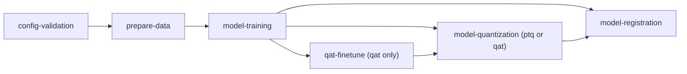

# YOLO pose pipeline

This pipeline trains a YOLO pose model (boxes plus keypoints) on your labelled images. You fill in a form and it trains the
model, logs the numbers to MLflow, keeps the weights, can make a smaller INT8 model, and registers the best one.
It is licensed AGPL-3.0 and co-owned with Infinite Orbits.



## The files that matter

| path | what it is |
|---|---|
| `pipeline.py` | the six steps and their order |
| `config/` | every setting; each plain value is a field on the run form |
| `steps/<name>/` | one folder for each step: `app/` and a `Dockerfile`; each has its own README |
| `step_tests/` | tests of the steps, see [`step_tests/README.md`](step_tests/README.md) |

What describes this pipeline, in `docs/`; edit it as the pipeline changes:

| file | what it holds |
|---|---|
| [`docs/the-pipeline.md`](docs/the-pipeline.md) | the six steps, what each reads and writes, and what is kept when a step is run again |
| [`docs/parameters.md`](docs/parameters.md) | every field of the run form with its default and bounds. Generated from `config/` by `python scripts/gen-parameters.py`; a test fails when it is out of date |
| [`docs/datasets.md`](docs/datasets.md) | the folder shape the pipeline reads, and the dataset it writes |
| [`docs/slurm.md`](docs/slurm.md) | what to know about the training step on an HPC (Slurm) site |

## Run it on your machine

Install kaos-lib at the version the step images use, then run the step tests, which run the steps the way the platform does:

```bash
pip install "$(sed -n 's/^ARG KAOS_LIB_PACKAGE="\(.*\)"$/\1/p' steps/*/Dockerfile | head -1)" pytest pillow pydantic psutil "mlflow>=3,<4" && python -m pytest
```

To run one step by hand, use [`kaosctl step run`](https://storage.googleapis.com/kaos-dev-511509-kaos-lib/docs/try-it-locally.html#run-steps-the-way-the-platform-does).

## The guide

[Run it](https://storage.googleapis.com/kaos-dev-511509-kaos-lib/docs/run-it.html) explains every idea this pipeline uses, one
page at a time. [A real pipeline](https://storage.googleapis.com/kaos-dev-511509-kaos-lib/docs/a-real-pipeline.html) reads this
pipeline's `pipeline.py` with what the first ten pages teach.
