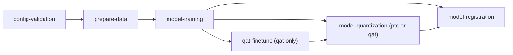

# yolo: train a pose model on the platform

yolo is the community pipeline for training YOLO pose models (boxes plus keypoints). You give it labelled images and fill in
a form. It trains the model, logs the numbers to MLflow, keeps the weights, can make a smaller INT8 model, and registers the
best one. It is built from the [hera template](https://novelcore.github.io/hera-pipeline-template/), is licensed
AGPL-3.0, and is co-owned with Infinite Orbits.

Read the guide first: it explains every idea this pipeline uses, one page at a time, from [Run it](https://storage.googleapis.com/kaos-dev-511509-kaos-lib/docs/run-it.html).
[A real pipeline](https://storage.googleapis.com/kaos-dev-511509-kaos-lib/docs/a-real-pipeline.html) reads this pipeline's `pipeline.py` with what the first ten pages teach. This site
holds what is specific to yolo:

| page | what it holds |
|---|---|
| [What the pipeline does](the-pipeline.md) | the six steps, what each reads and writes, and what is kept when a step is run again |
| [All the run-form fields](parameters.md) | every field of the run form, with its default and its bounds (generated from `config/`) |
| [Datasets](datasets.md) | the folder shape the pipeline reads, and the dataset it writes |
| [Run on HPC (Slurm)](slurm.md) | what to know about the training step on a Slurm site |

