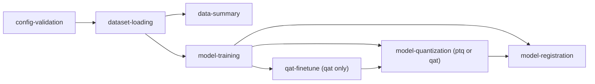

# The yolo pipeline

This template is a complete **YOLO pose training pipeline** for KAOS. Give it a labelled dataset,
pick a few options on a web form, and it trains a model, logs it to MLflow, keeps the weights in
lakeFS, and registers the best one.

It is built on the [hera pipeline template](https://novelcore.github.io/hera-pipeline-template/), and it is the worked use case of
**[the engineer's cookbook](https://novelcore.github.io/hera-pipeline-template/)**. The cookbook covers everything the two templates share:
access and roles, apps, tools, `kaosctl`, datasets, pull requests, runs and results. This guide
covers what is specific to yolo, and links back to the cookbook chapters for the rest.

## Your day with yolo

| | do this | where |
|---|---|---|
| 1 | sign in, find your project and role | [cookbook 1: You're in](https://novelcore.github.io/hera-pipeline-template/cookbook/1-youre-in/) |
| 2 | create a yolo app: **Pipelines** → **New pipeline** → the yolo card | [cookbook 2: Your project's apps](https://novelcore.github.io/hera-pipeline-template/cookbook/2-your-apps/) |
| 3 | open Argo, lakeFS, MLflow | [cookbook 3: Your tools](https://novelcore.github.io/hera-pipeline-template/cookbook/3-your-tools/) |
| 4 | install `kaosctl` (kaos-lib 0.4.0rc5 or newer) | [cookbook 4: Install kaosctl](https://novelcore.github.io/hera-pipeline-template/cookbook/4-install-kaosctl/) |
| 5 | upload labelled images, release `v1` | [Upload images and labels](guide-upload-images.md) |
| 6 | train on `v1`, then train again with other settings | [Train on a version and find the model](guide-train-and-find-the-model.md) |
| 7 | compare the two in MLflow and pick the weights | [Read your results](results.md), [Promote a model](promote.md) |

**[A day with yolo](worked-day.md)** walks through all of it in one page.

## The pipeline

Seven steps. Two of them run only when you turn quantization on:

[What the pipeline does](the-pipeline.md) explains each step.

## Changing the pipeline

The steps are ordinary hera steps. To add, write or remove one, follow the hera guide:
[add a step that reads the dataset](https://novelcore.github.io/hera-pipeline-template/guide-step-with-data/),
[write results from a step](https://novelcore.github.io/hera-pipeline-template/write-a-step/), [remove a step](https://novelcore.github.io/hera-pipeline-template/remove-a-step/),
[change a setting](https://novelcore.github.io/hera-pipeline-template/change-a-setting/), [send your change in](https://novelcore.github.io/hera-pipeline-template/send-it-in/).
How the yolo steps read data and write results is in
[How the steps use datasets](datasets-in-the-steps.md).

!!! note "Licence"
    The yolo template is a community template, licensed under AGPL-3.0. An app created from it
    inherits these terms for the template's code. See the repository's `LICENSE` and README.
