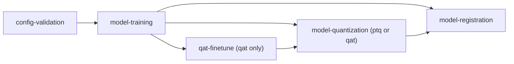

# yolo: train a pose model on KAOS

**yolo** is the community pipeline for training YOLO *pose* models (boxes plus keypoints) on KAOS. You give it labelled images and fill in a form. It trains the model, logs the numbers to MLflow, keeps the weights, can make a smaller INT8 model, and registers the best one.

You need a KAOS account and a project, and you should know Python and ML. You do not need to know how KAOS works inside. yolo is built on the [hera pipeline template](https://novelcore.github.io/hera-pipeline-template/) (the cookbook for KAOS pipelines in general) and is licensed AGPL-3.0, co-owned with Infinite Orbits.

## The journey

Each page has, for every step, what to do and what you should see.

| | page | result |
|---|---|---|
| 1 | [Prepare and upload a yolo dataset](prepare-dataset.md) | a checked dataset, merged |
| 2 | [Release a version and pick it](release-a-version.md) | `v1`, selectable in the run form |
| 3 | [Create a yolo pipeline](create-pipeline.md) | a pipeline in the console and a clone on your laptop |
| 4 | [Run the pipeline: small, then full, PTQ or QAT](run-small-and-full.md) | a trained model |
| 5 | [Results, weights and models in MLflow](results.md) | metrics, comparison, weights, a registered model |
| 6 | [Use a dataset shared with you](shared-dataset.md) | training on another project's data |
| 7 | [Run on HPC (Slurm)](slurm.md) | training on a supercomputer |
| | [When something breaks](troubleshooting.md) | the real messages and their fix |

Short on time? [A day with yolo](worked-day.md) does all of it in one page.

## The pipeline in one picture

[What each step does](the-pipeline.md). Every setting is a field of the run form: [all the fields](parameters.md).

## Reference

[Datasets](datasets.md), [kaos-lib versions](kaos-lib-versions.md), [Word list](glossary.md), and, optional, [how the steps read data and write results](datasets-in-the-steps.md). To change the steps themselves, follow the [hera cookbook](https://novelcore.github.io/hera-pipeline-template/).
