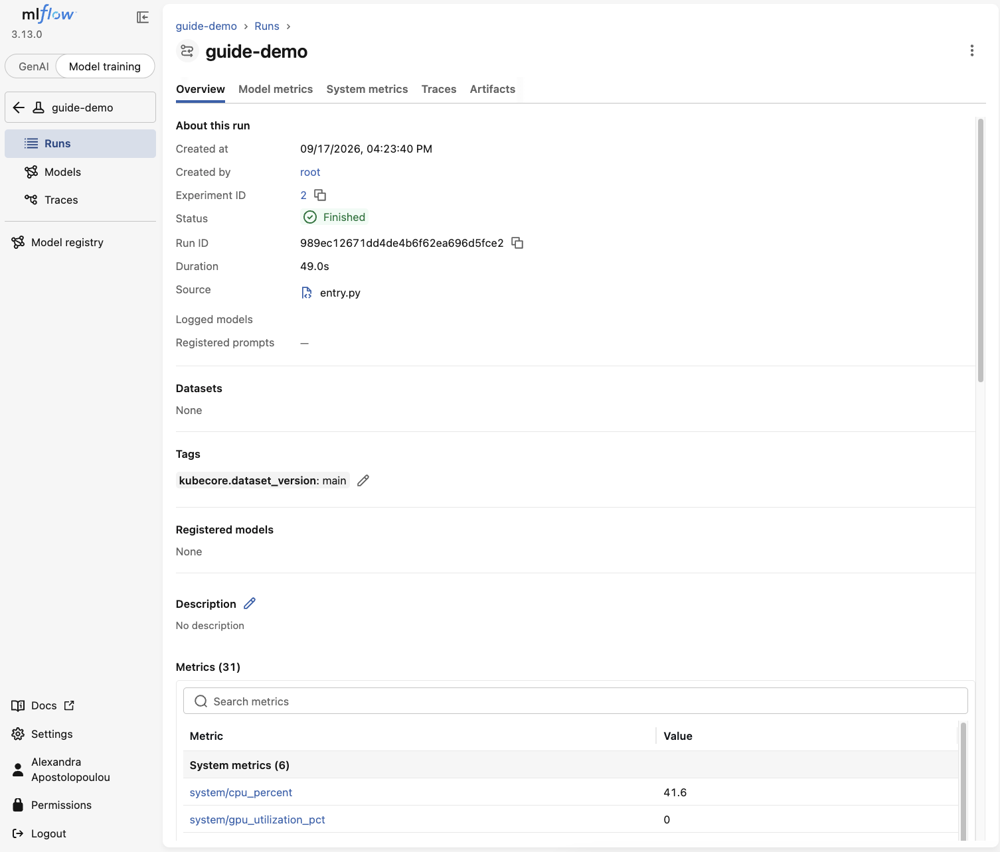
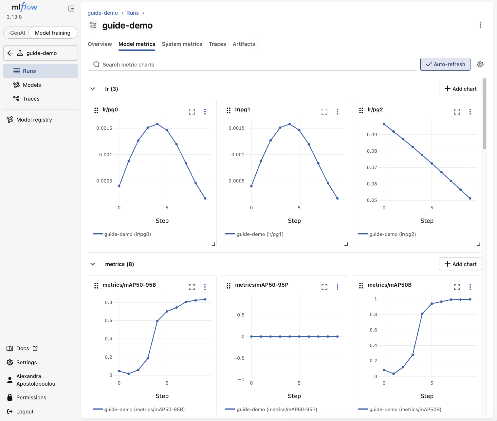
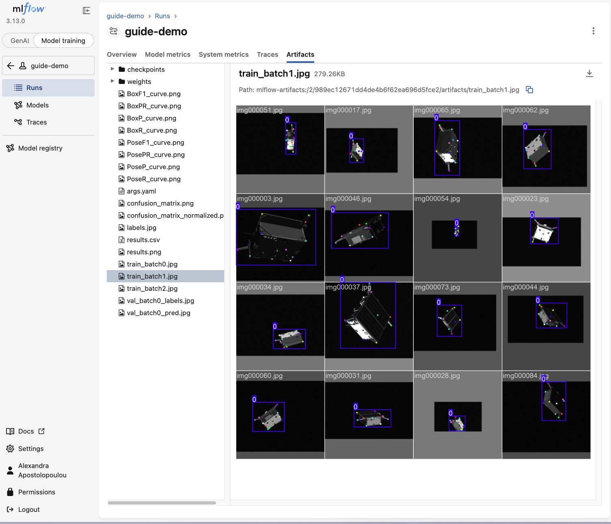

# 5. Results, weights and models in MLflow

**Goal:** read how your training went, compare runs, and get the weights.

*MLflow* is the results page every run writes to: numbers, charts, settings and a registry of models. Your *weights* (the model files) are not in MLflow: they are in the lakeFS repository `outputs-<pipeline>` (the **Outputs** link).

## Open MLflow

**Do:** in the console, open **Pipelines** and click your pipeline's **MLflow** link. Or **Models** in the console sidebar lists the registered models of your project, with **Open in MLflow**.

Find your run by the name you set in `experiment-name`. Click it to open it.



## What you will see

A run holds a few kinds of things.

- **Metrics.** Numbers that say how good the model is, and how they changed over the training rounds. You will see them as charts that move as training goes on.
- **Parameters.** The exact settings this run used. Every field you set on the form is saved here, so you always know what produced a result. Training adds `dataset.repo`, `dataset.version` and `dataset.lakefs_commit`: the exact data it trained on.
- **Artifacts.** The files the run produced, including the trained model and some example outputs.



The artifacts include example images with the model's predictions drawn on, so you can see at a glance what it learned.



## Your trained model, in the Models tab

Open your experiment and click the **Models** tab. Every finished training run adds one model there, named `<experiment-name>-best`: the best checkpoint of that run, `best.pt`.

- **Source run.** It links to the run that trained it.
- **Parameters** are the settings that shaped it: `epochs`, `imgsz` and `model_variant`.
- **Metrics** are its final validation scores: `val/mAP50`, `val/mAP50_95`, `val/precision` and `val/recall`. The tab lists every run's model with its scores, so you can see which run trained the best one.
- **Tags** say where its files are in lakeFS: `kaos.outputs_repo`, `kaos.outputs_commit` and `kaos.outputs_path`, plus `kaos.dataset_ref` (the dataset and version it trained on) and `kaos.workflow` (the run of the pipeline).

The model file itself is not stored in MLflow; it stays in lakeFS (see [Your files](#your-files)). The Models tab is the place to compare and pick models; the registry is the place for the ones you keep ([Promote a model](promote.md)).

Runs trained before this existed have no entry in the Models tab. Their results are in the run and in lakeFS as before.

## Comparing runs

Because every run saves its settings and its numbers, you can line two runs up side by side. Train once with a small model, once with a bigger one, and compare. Change the epochs and compare again. This is how you learn what works for your data.

1. Open the experiment, tick two or more runs, and click **Compare**. MLflow shows their parameters side by side, marks the ones that differ, and draws their metrics on one chart.
2. The experiment's **Models** tab lists each run's `<experiment-name>-best` with `val/mAP50`, `val/mAP50_95`, `val/precision` and `val/recall`, so you can sort by the score you care about.
3. To judge the weights yourself, download both `best.pt` files (below) and evaluate them on the same data. `kaosctl run --lock <mlflow-run-id> -- <your eval command>` makes your script read exactly the dataset commit that run trained on: training writes that **data lock** to its MLflow run (the `data.lock.json` artifact and the `kaos_lib.data.<repo>.commit` tag). See [cookbook 8](https://novelcore.github.io/hera-pipeline-template/cookbook/8-results-and-weights/).

## Why the settings are saved

You never have to remember what you did. If a run turns out well, its parameters are right there. You can read them, and set the same values again to repeat it. If a run turns out badly, you can see what to change.

## Your files

Checkpoints, exports and the INT8 model are not in MLflow's charts: they are in your pipeline's repository `outputs-<pipeline>` in lakeFS, branch `main`, one commit per step per run, under `checkpoints/<experiment>/<run>/` and `quantization/<experiment>/<run>/`. The commit's details name the dataset and the MLflow run, and the MLflow run names the commit back: its tags `kaos.outputs_repo`, `kaos.outputs_commit` and `kaos.outputs_path` say where the files are. The model in the Models tab carries the same tags. A registered model has its own tag on that commit, `model-<name>-v<version>` ([Promote a model](promote.md)). To download them:

```bash
kaosctl dataset pull outputs-<pipeline>@main ./weights --prefix checkpoints/<experiment>/<run>/
ls ./weights        # best.pt  last.pt  ...
```

The run's `kaos.outputs_path` tag gives the exact folder; the INT8 `.tflite` of a `ptq` or `qat` run is under `quantization/<experiment>/<run>/`. If a training step is run again, it resumes from the checkpoint the platform kept for it ([details](https://storage.googleapis.com/kaos-dev-511509-kaos-lib/docs/checkpoint.html)).

Happy with a model? Go to [Promote a model](promote.md).
