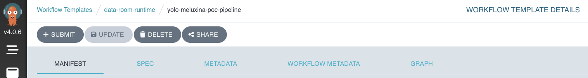
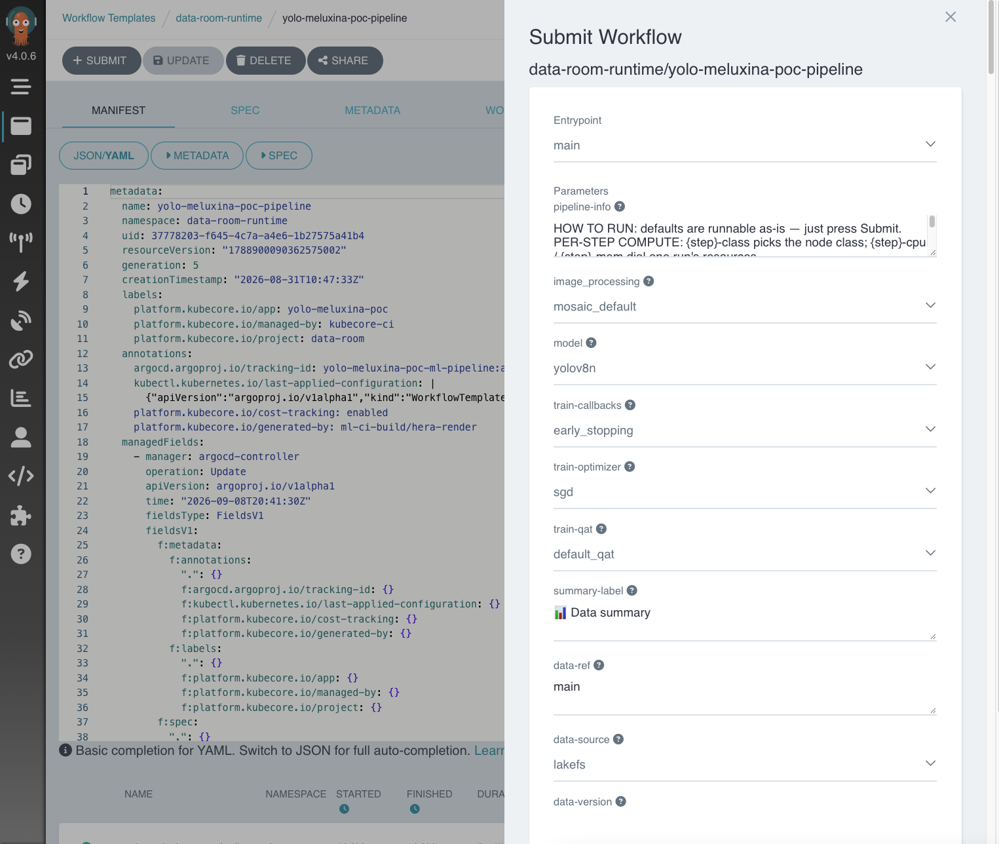
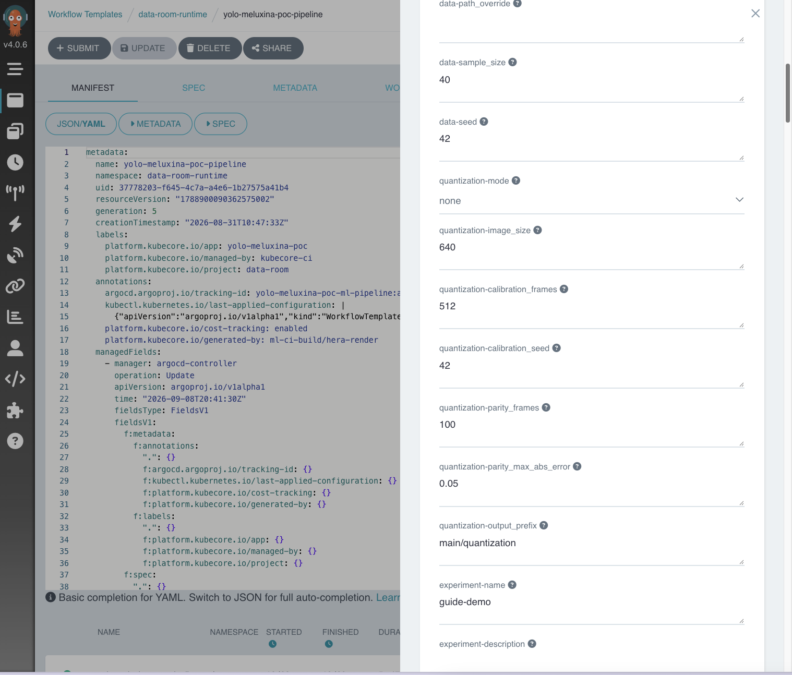

# 4. Run the pipeline: small first, then full

**Goal:** a quick run that proves everything works, then a full run, optionally with an INT8 model.

**Who can do it:** `dev`, `ops` or `admin` on the project. **You need:** a released dataset version ([step 2](release-a-version.md)).

## The run form

1. **Do:** console → **Pipelines** → your pipeline → **Run** (or in Argo: **Workflow Templates** → `<pipeline>-pipeline` → **Submit**).

    **You should see:** a form with many fields. Every field has a default; you only have to set `dataset`. [All the fields](parameters.md) are listed with their allowed values.

    

    

## A small run

2. **Do:** set these and leave the rest:

    | field | value |
    |---|---|
    | `experiment-name` | `spacecraft-small` |
    | `dataset` | `dataset-spacecraft@v1` |
    | `model` | `yolov8n` (the smallest) |
    | `train-epochs` | `10` |
    | `data-sample_size` | `50` (optional: train on 50 image pairs per split) |
    | `quantization-mode` | `none` |

    Then **Submit**.

    **You should see:** a live view of your run as boxes: `config-validation` and `dataset-loading` finish in seconds, `model-training` is the long one, `model-registration` ends it. `qat-finetune` and `model-quantization` show as *skipped*, which is normal ([Watch it train](watch-it.md)).

    

If `config-validation` turns red, its log names the field to fix ([Troubleshooting](troubleshooting.md)). This is cheap on purpose: it stops before any training time is spent.

## A full run

3. **Do:** submit again with the real settings: `experiment-name` = `spacecraft-pose`, the same `dataset`, `model` = `yolov8s` or `yolov11x` for more accuracy, `train-epochs` = `100`, and no `data-sample_size`. Several runs can go at once.

    **You should see:** the same boxes, training for hours rather than minutes. The run keeps going if you close the tab. If a training machine is reclaimed, **Retry** in Argo continues from the last saved checkpoint instead of starting over.

## Smaller INT8 model: PTQ or QAT

*INT8* is a smaller, faster form of the model for edge devices. Two ways to get it, chosen with `quantization-mode`:

| mode | what happens | when |
|---|---|---|
| `none` | no INT8 model | first runs |
| `ptq` | after training, `model-quantization` converts the model to INT8 TFLite using `quantization-calibration_frames` of your training images, and checks it against the full model | fast, good start |
| `qat` | `qat-finetune` first fine-tunes the model for INT8 (`train-qat-epochs`, on a GPU), then `model-quantization` packages the INT8 TFLite and checks it | better accuracy at INT8, slower |

4. **Do:** submit a run with `quantization-mode` = `ptq` (or `qat`) and `quantization-calibration_frames` of **at least 100** (default 512).

    **You should see:** `model-quantization` (and `qat-finetune` for `qat`) run instead of being skipped. The INT8 file `.tflite` lands in `outputs-<pipeline>` under `quantization/<experiment>/<run>/` ([Results](results.md)).

    The step also compares the INT8 model with the full one. The result is two MLflow metrics on the quantization run, `parity_max_abs_error` and `parity_passed` (passed means the difference is at most `quantization-parity_max_abs_error`, default 0.05). It does **not** fail the run: check `parity_passed` before you use the INT8 file.

!!! note "`calibration_frames` bounds"
    With `ptq` or `qat`, `quantization-calibration_frames` must be 100 to 10000. The first step checks it, so a wrong value fails in seconds, before training ([Troubleshooting](troubleshooting.md#quantizationcalibration_frames-must-be-between-100-and-10000-got-50)).

## Where it trains

By default training runs on a cluster GPU. To use a Slurm supercomputer, see [Run on HPC (Slurm)](slurm.md).

**Next:** [read the results](results.md).
