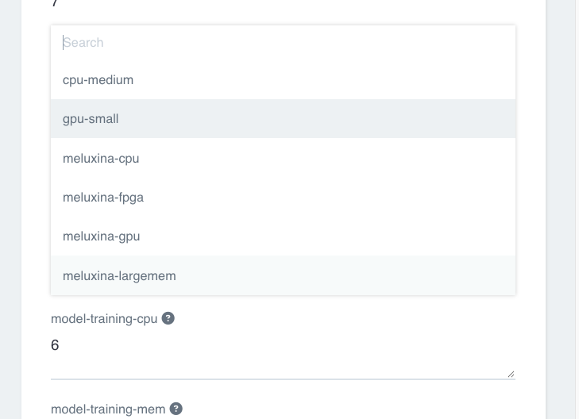

# 7. Run on HPC (Slurm)

**Goal:** send the training step to an HPC (Slurm) supercomputer, if your project has one.

*Slurm* is the job scheduler of a supercomputer. In KAOS the HPC machines come from a provider; today that is MeluXina, Luxembourg's supercomputer. Only projects connected to it see its machines.

1. **Do:** open the run form and look at the `model-training-class` dropdown (the form's read-only `pipeline-info` field at the top also lists the classes). The console's **Machines** page shows the same classes.

    **You should see:** the cluster classes, and, if your project has HPC, classes whose names start with `meluxina` (the provider's name), such as `meluxina-gpu`. No `meluxina` entries means your project is not connected: ask your KAOS contact.

    

2. **Do:** set `model-training-class` to `meluxina-gpu` and submit as usual ([Run the pipeline](run-small-and-full.md)). The other steps stay where they are.

    **You should see:** `model-training` waits first (the HPC cluster is shared, so the job can queue for a while; that is normal), then runs. The dataset is copied to the machine before the job starts, and the weights come back to `outputs-<pipeline>` exactly as for a cluster run.

Things to know:

- **Time limit:** training on HPC has a 12-hour limit (`hpc_time_limit="12h"` on `model-training` in `pipeline.py`). Raise it there for longer trainings.
- **Long trainings continue:** `model-training` is resumable (`resumable=True` in `pipeline.py`). About 10 minutes before its wall time it saves `last.pt` at the end of an epoch, and training continues from it in a new job, up to 5 times. Each new job waits in the queue again and counts against your budget.
- **INT8 steps** have their own `<step>-class` fields; leave them on the cluster unless you need otherwise.
- **Which machine otherwise:** leave the class dropdowns alone and training runs on a cluster GPU.

More (the classes, staging, time limits, what to do when a job waits or stops): [the Run on HPC (Slurm) page of the hera cookbook](https://novelcore.github.io/hera-pipeline-template/hpc/). See also [When something breaks](troubleshooting.md#a-step-waits-and-never-starts).
